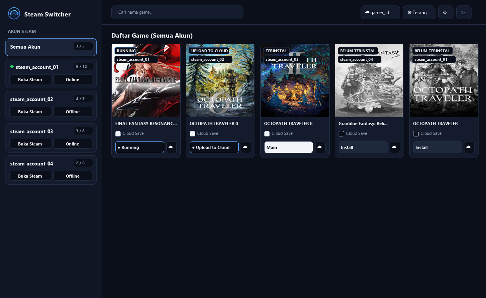
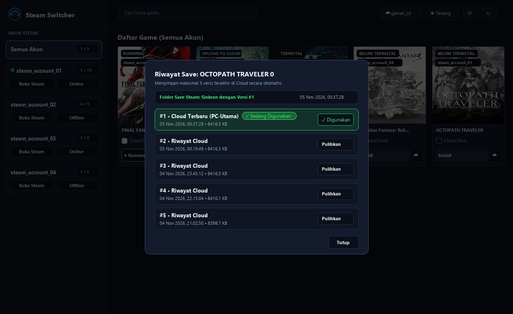

# 🎮 Steam Switcher

<p align="center">
  
</p>

**Steam Switcher** adalah aplikasi desktop ringan dan *portable* untuk Windows yang memudahkan pengelolaan **banyak akun Steam (Multi-Account / Shared Account)** sekaligus menyediakan fitur **Self-Hosted Cloud Save** pintar antar-perangkat.

Dirancang agar langsung terbuka dalam hitungan detik, mendeteksi seluruh akun dan *game* Steam secara otomatis, mengganti akun tanpa perlu *login* ulang, serta menyinkronkan *file save game* ke server pribadi Anda.

---

## 🖼️ Tampilan Aplikasi

### Halaman Utama (Daftar Akun & Game)


### Riwayat Cloud Save (5 Versi Terakhir & Penanda Save Aktif)


---

## ✨ Fitur Utama

- **⚡ Instant Multi-Account Switcher**
  - Otomatis membaca seluruh akun Steam yang pernah *login* di PC Anda (`loginusers.vdf`).
  - Berpindah akun Steam atau langsung menjalankan *game* dari akun tertentu hanya dengan **1 klik** (otomatis *switch* akun & membuka *game*).
- **🌐 Kontrol Mode Online / Offline per Akun**
  - Atur apakah akun tertentu berjalan dalam mode **Online** atau **Offline** langsung dari *sidebar* tanpa perlu masuk ke pengaturan Steam.
- **☁️ Self-Hosted Cloud Save (Per-Game Opt-In)**
  - Hemat ruang server: secara *default* Cloud Save tidak aktif, dan hanya menyinkronkan *game* yang Anda centang **`[✓] Cloud Save`**.
  - **Auto-Sync Saat Main & Berhenti**: Otomatis mengecek *save* terbaru sebelum *game* dijalankan, dan otomatis meng-*upload* *save* ke Cloud (`Upload to Cloud`) begitu Anda menutup *game*.
  - **Deteksi Konflik Pintar**: Memberi pilihan jika *file save* di PC lokal lebih baru daripada di Cloud.
- **🕒 Riwayat Cloud Save (Maksimal 5 Versi) + Deteksi Save Aktif**
  - Menyimpan hingga **5 versi *save* terakhir** di server Cloud secara otomatis (versi lebih lama otomatis dibersihkan).
  - Membandingkan langsung isi folder *save* asli di Steam (`userdata` / dokumen *game*) dengan daftar versi di Cloud dan menandai versi mana yang **`✓ Sedang Digunakan`** tanpa membuat *folder backup* ganda di lokal.
- **🏆 Personal Achievement Tracker (Khusus Save Anda)**
  - Tetap bisa melihat dan mengumpulkan **Achievement Resmi Steam** meskipun bermain dalam **Mode Offline** atau menggunakan **Akun Sharing**.
  - Mengisolasi data *achievement* khusus untuk *save* Anda sendiri (tidak tercampur dengan pemain lain di akun sharing) dan otomatis menyinkronkannya ke dalam paket **Cloud Save** Anda.
- **📦 100% Portable Single `.exe`**
  - Seluruh pengaturan disimpan rapi di Windows Registry (`HKCU\Software\SteamSwitcher`), sehingga `SteamSwitcher.exe` dapat ditaruh di mana saja tanpa membuat *file* konfigurasi atau *folder* tambahan di sebelahnya.
  - Dilengkapi fitur **System Tray** (*On exit hide to tray* & *Start at Windows startup*).

---

## 📋 Apa Saja yang Perlu Disiapkan?

### 1. Untuk Pengguna Aplikasi (`SteamSwitcher.exe`)
- **Sistem Operasi**: Windows 10 atau Windows 11 (64-bit).
- **Aplikasi Steam**: Sudah terinstal di PC.
- **Akun Steam**: Login terlebih dahulu akun-akun Steam Anda di aplikasi Steam resmi minimal satu kali dengan mencentang **"Remember Me" (Ingat Saya)** agar terdaftar di sistem Steam lokal.

### 2. Untuk Build dari Source Code (Opsional / Developer)
Jika Anda ingin menjalankan langsung dari kode sumber (`server.py`) atau mem-*build* ulang file `.exe`:
- **Python 3.10+**
- Paket pendukung (untuk ikon *System Tray* dan *compiler* `.exe`):
  ```powershell
  pip install pystray pillow pyinstaller
  ```

### 3. Untuk Server Cloud Save Pribadi (Opsional)
Jika Anda ingin menggunakan fitur **Cloud Save** lintas PC:
- Sebuah **VPS / Home Server** (Linux/Windows) dengan **Docker & Docker Compose** (atau Python 3.10+).
- Domain / Subdomain (opsional, misalnya via Nginx / Cloudflare Tunnel) atau IP Publik VPS.

---

## 🚀 Cara Instalasi & Penggunaan

### Cara A: Menggunakan File Portable (`SteamSwitcher.exe`)
1. Unduh atau salin file **`SteamSwitcher.exe`** ke lokasi mana pun di PC Anda.
2. Klik 2x **`SteamSwitcher.exe`** untuk membuka aplikasi.
3. *(Catatan Pertama Kali Buka)*: Jika PC belum memiliki *runtime* antarmuka bawaan, aplikasi akan menyiapkannya secara otomatis di `%LOCALAPPDATA%\SteamSwitcher` pada pembukaan pertama.

### Cara B: Menjalankan dari Source Code / Build Sendiri
1. **Jalankan langsung dengan Python:**
   ```powershell
   python server.py
   ```
2. **Build menjadi satu file `SteamSwitcher.exe` (Portable):**
   ```powershell
   pyinstaller --noconfirm --onefile --windowed --name "SteamSwitcher" --icon "logo.ico" --add-data "index.html;." --add-data "logo.png;." --add-data "logo.ico;." --add-data "webview2_runtime;webview2_runtime" server.py
   ```
   File hasil *build* akan tersedia di folder `dist/SteamSwitcher.exe`.

---

## 📖 Panduan Pemakaian Aplikasi

1. **Memilih & Mengganti Akun Steam**
   - Klik nama akun di *sidebar* kiri untuk memfilter daftar *game* milik akun tersebut, atau pilih **Semua Akun**.
   - Klik tombol **`Buka Steam`** pada kartu akun jika hanya ingin berpindah akun Steam tanpa menjalankan *game*.
   - Klik tombol **`Online` / `Offline`** pada kartu akun untuk mengubah mode *login* akun tersebut.

2. **Menjalankan atau Menginstal Game**
   - Klik tombol **`Main`** pada kartu *game* yang sudah terinstal (atau **`Install`** jika belum terinstal).
   - Aplikasi akan otomatis menutup sesi Steam lama (jika berbeda akun), mengganti ke akun pemilik *game*, menyinkronkan *save* (bila Cloud Save dicentang), dan menjalankan *game*.

3. **Menggunakan Cloud Save & Riwayat Save**
   - Klik tombol **`☁ Login Cloud`** di kanan atas, masukkan **Server URL**, **Username**, dan **Password** Anda, lalu klik **Register** (untuk akun baru) atau **Login**.
   - Centang **`[✓] Cloud Save`** pada *game* yang ingin Anda simpan ke Cloud.
   - Saat *game* sedang dimainkan, tombol akan berstatus **`Running`**. Begitu Anda keluar dari *game*, tombol akan berubah menjadi **`Upload to Cloud`** selama proses *upload* otomatis berlangsung, lalu kembali menjadi **`Main`**.
   - Klik tombol ikon awan (**`☁`**) di sebelah tombol `Main` untuk melihat **maksimal 5 riwayat *save* terakhir** di Cloud, melihat versi mana yang **`✓ Sedang Digunakan`** di folder Steam PC Anda saat ini, atau menekan **`Pulihkan`** untuk kembali ke versi *save* sebelumnya.

---

## ☁️ Cara Setup Server Cloud Save (`cloud-server`)

Folder [`cloud-server/`](./cloud-server) berisi *backend* ringan untuk menyimpan *file save* dan riwayat versi per pengguna.

### Menjalankan dengan Docker Compose (Direkomendasikan)
1. Salin folder `cloud-server` ke VPS atau server Anda.
2. Masuk ke direktori tersebut dan jalankan:
   ```bash
   cd cloud-server
   docker compose up -d
   ```
3. Server Cloud Save akan aktif di port **`8765`** (`http://IP-SERVER-ANDA:8765`).
4. Seluruh data akun dan *file save* tersimpan aman di dalam volume `./saves_data`.
5. *(Opsional)* Anda dapat menghubungkan port `8765` ke domain/subdomain menggunakan Reverse Proxy (Nginx / Caddy / Cloudflare Tunnel).

---

## 📁 Struktur Proyek

```text
├── server.py                  # Aplikasi utama Desktop, Steam Parser, & Cloud Sync Engine
├── index.html                 # Antarmuka pengguna (UI) berbasis tema Gelap & Terang
├── logo.png / logo.ico        # Aset ikon aplikasi & System Tray
├── webview2_runtime/          # Native C# WinForms + WebView2 Host ringan (~1 MB)
├── cloud-server/
│   ├── cloud_server.py        # Server API Cloud Save mandiri (Multi-user & 5-Version History)
│   ├── Dockerfile             # Konfigurasi image Docker
│   └── docker-compose.yml     # Konfigurasi deployment Docker Compose
└── README.md                  # Dokumentasi proyek
```

